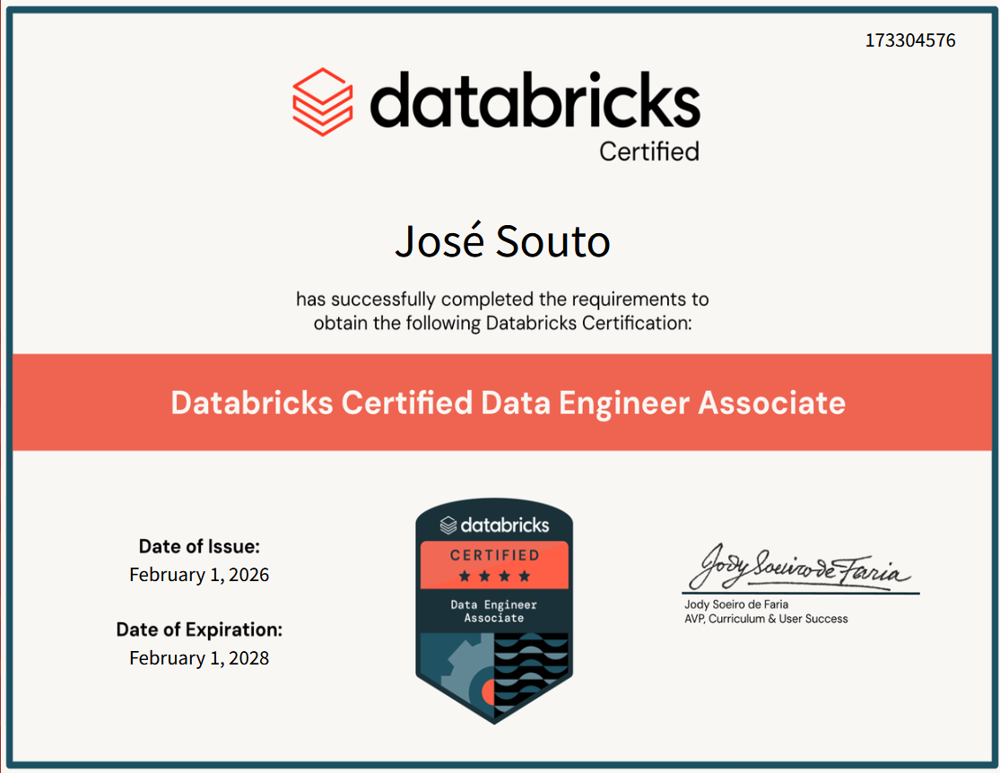
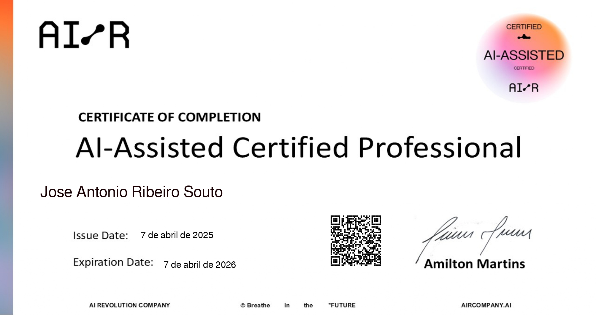
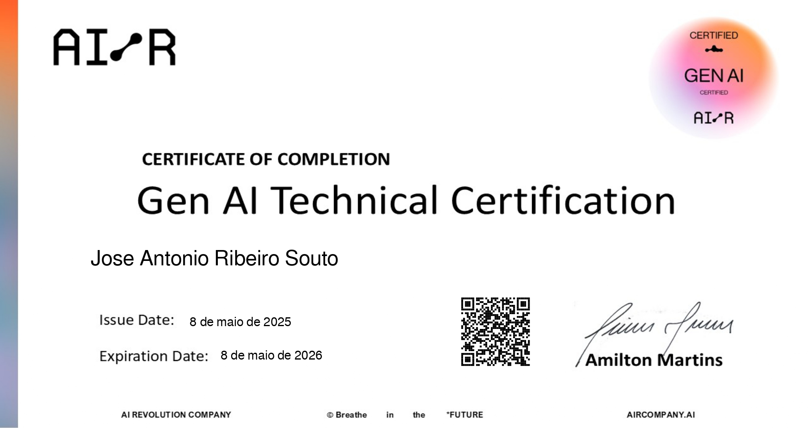

# José Antonio Ribeiro Souto

  <strong>Data Engineer • Data Science • Cloud & Analytics</strong>

  Construindo soluções orientadas a dados, integrando tecnologias e transformando informações em valor para o negócio.

  
  
  

 <!--

 -->

## 👨‍💻 Sobre mim

Sou graduado em **Sistemas de Informação pelo IF Goiano** e atuo na área de tecnologia, com foco em **Engenharia de Dados, Cloud Computing e Analytics**.

Tenho experiência no desenvolvimento e manutenção de pipelines de dados, processos ETL, migração entre plataformas, transformação e validação de dados.

Ao longo da minha trajetória, participei de projetos envolvendo diferentes tecnologias e ambientes de dados, trabalhando com soluções em nuvem e ferramentas de processamento e orquestração.

Atualmente, estou cursando pós-graduação em **Data Science e Analytics**, aprofundando meus conhecimentos em análise de dados, Big Data e Inteligência Artificial.

Meu objetivo é continuar evoluindo tecnicamente e me tornar um profissional sólido, capaz de desenvolver soluções eficientes, escaláveis e orientadas a dados.

 
## ⚡ Experiência técnica

- Desenvolvimento e manutenção de pipelines de dados e processos ETL.
- Migração de dados entre diferentes plataformas e ambientes de nuvem.
- Migração de dados do BigQuery para Snowflake, com adaptação e validação de consultas SQL.
- Migração de pipelines e orquestrações do GCP para AWS utilizando Apache Airflow.
- Migração de análises e dashboards do Looker para Amazon QuickSight.
- Desenvolvimento de consultas SQL e scripts Python para transformação e processamento de dados.
- Utilização de dbt para transformação e organização de dados.
- Testes de equivalência e validação da qualidade, consistência e integridade dos dados.

 

## 🛠️ Tecnologias e ferramentas

### Linguagens e processamento de dados

  
  
  
  

### Engenharia de Dados

  
  
  

### Cloud Computing

  
  

### Bancos de Dados e Data Warehousing

  
  
  
  

### BI e Visualização de Dados

  
  

### Ferramentas

  
  
  

 

## 🎓 Formação acadêmica

- **Pós-graduação em Data Science e Analytics** — UNESC Digital (2026 – Atual).
- **Bacharelado em Sistemas de Informação** — IF Goiano (2021 – 2026).

 

## 🏅 Minhas certificações

### Databricks Certified Data Engineer Associate

### AWS Certified Cloud Practitioner

### Microsoft Certified: Azure AI Fundamentals

### Compass UOL — AI-Assisted Certified Professional

### Compass UOL — Gen-AI Certified Professional

 

## 🎯 Foco atual

Aprofundando meus conhecimentos e evoluindo continuamente nas seguintes áreas:

- Engenharia de Dados e arquitetura de pipelines.
- Cloud Computing e soluções distribuídas.
- Big Data e processamento de grandes volumes de dados.
- Data Science, Analytics e Machine Learning.
- Inteligência Artificial e suas aplicações.

**Sempre aprendendo, desenvolvendo e buscando novos desafios na área de tecnologia.**
