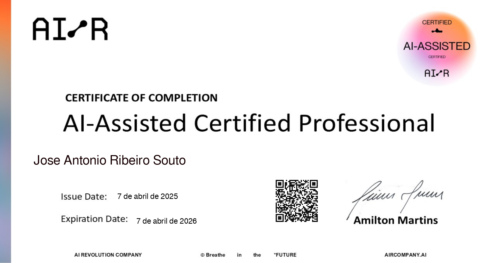
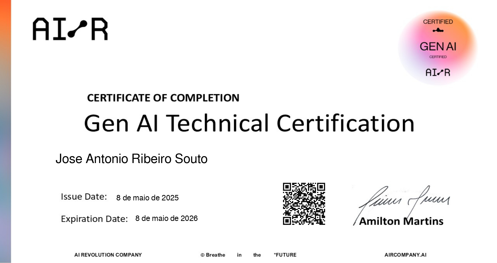

## José Antonio Ribeiro Souto 

<h3>Sobre mim</h3>

- 👨‍💻 &nbsp; Engenheiro de Dados com experiência em migração de dados e pipelines, transformação e validação de dados.
- 🎓 &nbsp; Graduado em **Sistemas de Informação** pelo <a href="https://www.ifgoiano.edu.br/home/index.php/urutai.html">IF Goiano - Campus Urutaí</a>.
- 📚 &nbsp; Cursando pós-graduação em **Data Science e Analytics**.
- ☁️ &nbsp; Experiência com **SQL, Python, AWS, Apache Airflow, Snowflake, BigQuery, dbt e Amazon QuickSight**.
- 🚀 &nbsp; Experiência em projetos de migração de dados, pipelines de ETL e validação da qualidade e consistência dos dados.
- 🏅 &nbsp; Certificado **Databricks Certified Data Engineer Associate** e **Microsoft Azure AI Fundamentals**.
- 🌱 &nbsp; Aprofundando conhecimentos em **Engenharia de Dados, Cloud Computing, Big Data e Inteligência Artificial**.
- 💼 &nbsp; **Experiências Profissionais:**
  - Engenheiro de Dados na Compass UOL (2024–2026).
  - Estagiário em Engenharia de Dados na Compass UOL (2023).
  
<h3>Minhas Certificações</h3>

- **<a href="https://credentials.databricks.com/bc73b235-0ccd-4ae8-8813-b1e41033f44f#acc.QC9fDYFu">Databricks Certified Data Engineer Associate</a>**

&nbsp;&nbsp;&nbsp;&nbsp;&nbsp;&nbsp;&nbsp;

- **<a href="https://www.credly.com/badges/6ca11699-8873-4697-8a9f-f9c0ffbfbd7c/public_url">AWS Certified Cloud Practitioner</a>**

&nbsp;&nbsp;&nbsp;&nbsp;&nbsp;&nbsp;&nbsp;

- **<a href="https://learn.microsoft.com/api/credentials/share/en-us/JoseSouto-0313/46D7389665CF292E?sharingId=6633DAD2C34BCD2B">Microsoft: Azure AI Fundamentals</a>**

&nbsp;&nbsp;&nbsp;&nbsp;&nbsp;&nbsp;&nbsp;

- **<a href="JoseSoutoIA/AI-Assisted_Certified_Professional.pdf">Compass.UOL - AI-Assisted Certified Professional</a>**

&nbsp;&nbsp;&nbsp;&nbsp;&nbsp;&nbsp;&nbsp;

- **<a href="JoseSoutoGenIA/GenAI_Technical_Certification.pdf">Compass.UOL - Gen-AI Certified Professional</a>**

&nbsp;&nbsp;&nbsp;&nbsp;&nbsp;&nbsp;&nbsp;

<h3>Minhas Skills</h3>

**Aplicações e dados**

**Utilidades**

**DevOps**

<h3>Minhas Estatisticas</h3>

 

  

    

